# ScanNasYork — System Overview, Functional (FR) & Non-Functional Requirements (NFR)

This document provides a detailed overview of the system architecture, along with the functional and non-functional requirements of the **ScanNasYork Quantamental Stock Screener**. This documentation reflects the state of the codebase following the Hybrid Data Architecture migration, which optimized database performance for 5,000+ Nasdaq stocks.

---

## 1. System Overview

### 1.1 Project Goal & Scope
**ScanNasYork** is a web-based quantamental stock screener for Nasdaq and NYSE listings. The system allows users to filter and analyze thousands of stocks using technical indicators (e.g., RSI, MACD, Bollinger Bands, ATR) and fundamental parameters (e.g., P/E ratio, EPS, Revenue, EPS YoY growth). It provides interactive charting and analyst forecasts on demand. Prices reflect the latest data returned by the source, rather than a guaranteed real-time market feed.

### 1.2 System Architecture
Financial history is loaded immediately using the read-only `/:symbol/financial-chart` endpoint, independently of the snapshot's upstream refresh. Saved MySQL series remain visible when refreshing sources fails or returns no history. Empty saved history and database read errors have distinct UI states. TTM summary values cannot substitute for annual/quarterly history.

The root route `/` and default `/index.html` serve the Hero home page introducing the workflow and showing a read-only preview of saved stocks. The screener is available at `/screener.html`; stock links open `/stock.html?symbol=...` and trigger the selected-stock refresh described below. Legacy `/home.html` and unknown browser routes redirect to Hero. Explicit screener, Forex and stock links remain directly accessible; there is no first-visit cookie or forced session redirect. Unknown API routes retain a JSON 404 response.

The application is designed using a **Hybrid Data Architecture**:
1. **Pre-computed Storage (MySQL DB):** Standard query parameters, basic metadata, sector types, and latest technical/fundamental metrics are calculated/compiled by background workers and stored directly in the `Tickers` table. This allows the stock screener to perform high-speed filtering, sorting, and pagination across 5,000+ equities in a single indexed query.
2. **On-Demand Stock Refresh (Express.js API):** Opening a stock detail page requests `/:symbol/snapshot`. On a cache miss, the API refreshes daily candles, price, technical indicators, company fundamentals, analyst forecasts and SEC financial history for that symbol only, then saves applicable data in MySQL. Results with complete financial history are cached for 60 seconds per stock; missing financial series are retried immediately on the next open, while reusing cached price/company data; concurrent requests share one refresh. Opening another stock has its own refresh/cache. A page left open does not poll automatically.
3. **Historical Financial Storage:** SEC EDGAR company facts and selected-stock Yahoo historical fallback data (including reporting currency/source) are upserted into `income_statements` by either the selected-stock refresh or the optional bulk fundamental worker. Screener search itself reads MySQL and does not trigger these upstream requests. Bulk workers remain available to pre-populate screening fields across the market.
4. **Country Economics:** The Forex workspace compares selected-country policy benchmarks and headline inflation from BIS. Source-labelled snapshots with recent observations are stored in `economic_series`; on-demand six-hour checks refresh expired snapshots in the background. The existing FRED US backdrop remains separate. National release dates, consensus forecasts and core inflation are not inferred from these snapshots.

#### Architecture & Data Flow Diagram

```mermaid
graph TD
  subgraph Client Browser [Client Browser]
    FE_UI[HTML / CSS / JS Frontend]
    TV_Chart[TradingView Lightweight Charts v4]
    FE_UI --> TV_Chart
  end

  subgraph Express API Gateway [Express.js Backend Server]
    Router[Express Router]
    Validator[Joi Validators]
    Controller[Stock and Market API Handlers]
    Cache[In-Memory Cache Map]
    
    Router --> Validator
    Validator --> Controller
    Controller <--> Cache
  end

  subgraph Database Layer [MySQL Database]
    DB_Tickers[(Tickers Table - Stores Latest Aggregates)]
    DB_Fundamental[(Income Statements - SEC Reporting History)]
    DB_Economics[(Economic Series - Country Snapshots)]
  end

  subgraph Data Synchronizer [Background Workers]
    W_Tech[daily-technical.js Worker]
    W_Fund[fundamental.js Worker]
    Math_Utils[indicators.js - RSI/MACD/BB/ATR math]
    
    W_Tech --> Math_Utils
  end

  subgraph External APIs [External Services]
    API_Yahoo[Yahoo Finance API]
    API_SEC[SEC EDGAR API]
    API_FRED[FRED Public Economic Series]
    API_BIS[BIS Policy Rates and Consumer Prices]
    API_Poly[Nasdaq Trader Symbol Directory]
  end

  %% Client and Backend Interaction
  FE_UI <-->|REST API| Router

  %% Controller Interactions
  Controller <-->|Sequelize ORM| DB_Tickers
  Controller <-->|Sequelize ORM| DB_Fundamental
  Controller <-->|On-Demand HTTP| API_Yahoo
  Controller <-->|Selected stock SEC refresh| API_SEC
  Controller <-->|Selected stock Yahoo financial history fallback| API_Yahoo
  Controller <-->|Forex and commodity candles and quotes| API_Yahoo
  Controller <-->|Dated US economic observations| API_FRED
  Controller <-->|Country policy and CPI| API_BIS
  Controller <-->|Durable economic fallback| DB_Economics
  Controller -->|Save matching chart price; invalidate screener cache| DB_Tickers

  %% Worker Interactions
  W_Tech <-->|Fetch 50d prices| API_Yahoo
  W_Tech -->|Bulk Update Indics/Prices| DB_Tickers
  W_Fund <-->|Fetch CIks & Annual/Quarterly reports| API_SEC
  W_Fund <-->|Fetch EPS/PE/Revenue/Growth| API_Yahoo
  W_Fund -->|UPSERT Fundamentals| DB_Fundamental
  W_Fund -->|Bulk Update Tickers| DB_Tickers
  API_Poly -.->|Initial Seed Only| DB_Tickers
```

### 1.3 Technical Stack
- **Backend:** Node.js (LTS), Express.js framework, Sequelize ORM, MySQL (8.0+) Database.
- **Frontend:** Vanilla HTML5, Vanilla CSS3 (with dynamic dark-mode styling), Vanilla ES6 JavaScript.
- **Charts:** TradingView Lightweight Charts (v4.x) for candlestick prices and volume; standard canvas rendering for fundamental income statements (Revenue/EPS).
- **Data Integrations:** Yahoo Finance (`yahoo-finance2` library), SEC EDGAR API (JSON Company Facts), Nasdaq Trader symbol directories (initial symbol import); optional FMP earnings calendar.

---

## 2. Functional Requirements (FR)

Functional requirements describe the specific features and actions that the ScanNasYork system must execute.

### 2.1 FR-1: Stock Screener Engine
* **FR-1.1: Filter Multi-Criteria:** The system must filter stocks using combinations of fundamental and technical criteria:
  - *Technical criteria:* RSI (7/14 range), MACD status (positive/negative histogram crossover), Base Building / Low Volatility (Bollinger Band Squeeze where bandwidth <= 5%).
  - *Fundamental criteria:* EPS range (TTM), EPS YoY Growth percentage, P/E Ratio range, Revenue range (TTM), Market Cap range.
  - *Sector/Industry:* Filter by sector categories.
  - *Text Search:* Trim whitespace and match case-insensitively. An exact existing ticker restricts results to that ticker, while all other filters still apply; do not substitute company-name matches when the ticker is excluded by filters. If no exact ticker exists, search partial symbols and company names using literal text (escape SQL LIKE wildcards). Search automatically 350ms after typing stops; Enter/Screen executes immediately and cancels the pending timer. Only the latest frontend search request may update results or the loading state. Empty results with active filters offer Clear filters, keep search. Reset must clear numeric/sector/toggle filters and Watchlist mode as well as the search text.
* **FR-1.2: Database Query Performance:** The screener queries must execute against pre-computed fields in `tickers`, without historical-price joins.
* **FR-1.3: Pagination and Sorting:** The screener must support `limit`, `offset` (pagination), and `sort_by` fields (e.g., market_cap, rsi_14, current_price, etc.) sorting in both `ASC` and `DESC` orders, keeping null values last.
* **FR-1.4: Caching:** Screener API queries must be cached in backend memory using a TTL (Time-To-Live) cache (default 5 minutes) to ensure repetitive user queries return instantaneously.
* **FR-1.5: CSV Data Export:** The frontend UI must allow downloading the currently filtered and retrieved screener dataset directly as a standard comma-separated values (CSV) file.

### 2.2 FR-2: Detailed Stock Overview & Fundamental Visualization
* **FR-2.1: Stock Detail view:** When clicking on a stock symbol, the user must be redirected to `stock.html?symbol=[SYMBOL]` showing detailed metadata:
  - Company name, sector, industry, and market capitalization.
  - Current price, daily change (%), and current trading volume.
  - Calculated technical indicators (RSI 14, RSI 7, MACD, MACD Signal, MACD Hist, Bollinger Bands, ATR 14).
  - On successful chart refresh, the header price must be replaced with the close of the latest plotted candle from the same response, rather than remaining at the saved database price.
  - Daily percentage change must use the snapshot price and the previous daily close when available. On an uncached stock opening, daily chart bars must recalculate volume and technical indicators and advance the technical checkpoint after successful persistence. Non-daily interval changes must not recalculate daily indicators from weekly/monthly candles.
* **FR-2.2: Historical Financials Table:** The detail page must show tabular financial lists extracted from the [Income_Statements table](backend/db/schema.sql):
  - *Annual History:* Fiscal Year, Revenue, Net Income, EPS, and Report Date.
  - *Quarterly History:* Fiscal Period (e.g. Q1 2025), Revenue, Net Income, EPS, and Report Date.
* **FR-2.3: Fundamental Financial Charts:** The UI must display an interactive bar chart illustrating historical Revenue and Earnings Per Share (EPS) for both annual and quarterly frequencies, showing chronological oldest-to-newest progress (Zero Data Loss).

### 2.3 FR-3: On-Demand Candlestick Price Charts
* **FR-3.1: TradingView Chart Rendering:** The system must render stock price charts using the TradingView Lightweight Charts library inside the details page, displaying:
  - Candlestick Series (Open, High, Low, Close).
  - Volume Histogram Series (synchronized on the same time scale).
* **FR-3.2: Multi-Timeframe Period Selection:** Users must be able to switch chart views instantly with the following configuration specifications:
  
  | Timeframe Selector | Fetch Back Date Period | Data Interval | Chart Resolution |
  | :--- | :--- | :--- | :--- |
  | **1D** | All-time | 1 Day (`1d`) | Daily Close |
  | **1W** | All-time | 1 Week (`1wk`) | Weekly Close |
  | **1M** | All-time | 1 Month (`1mo`) | Monthly Close |
  | **3M** | All-time | 3 Months (`3mo`) | Quarterly Close |

* **FR-3.3: Proxy On-Demand Fetching:** Historical candles must not be persisted in the local database by the chart endpoint. The backend queries Yahoo Finance and returns formatted candles plus `price_snapshot` containing price, daily change when available, candle date, and fetch timestamp. The snapshot price and percentage change are saved to `tickers`.
* **FR-3.4: Selected-Stock Refresh:** Opening a stock fetches one selected-stock snapshot. Complete financial history uses the 60-second cache. Missing annual/quarterly Revenue or EPS history triggers an immediate SEC + Yahoo retry on the next open, reusing cached price/company data and coalescing concurrent requests. Retries do not extend the original cache expiry. Interval clicks keep their separate 1-minute chart cache. No periodic polling is started.
* **FR-3.5: Consistent Snapshot and Request Ordering:** Header price and candles must update from one successful response. When interval requests overlap, only the most recent user request may update the visible price, chart and active interval. Simultaneous backend requests for the same symbol and interval must share one in-flight fetch.
* **FR-3.6: Persistence and Checkpoints:** Successful on-demand data must update only the selected symbol and invalidate screener caches. Daily chart refresh recalculates indicators before advancing `last_technical_update`; Yahoo company data advances `last_fundamental_update`. SEC statement upserts, derived growth streak and `last_sec_update` must commit in one transaction. Weekly/monthly chart refresh updates price only without advancing the daily-indicator checkpoint.
* **FR-3.7: Partial Failures:** Failure to load saved company details or financial history must not prevent a successful price/chart snapshot from appearing. A failed chart refresh must show an error and preserve the last successful visible snapshot. If no chart has loaded yet, any saved database price must be identified as such by the error message, and a later interval click must allow recovery.
* **FR-3.8: Financial Source Fallback:** When financial history is missing, request SEC and Yahoo historical financials concurrently for that symbol only. When history already exists, normally refresh SEC; if SEC fails or has no supported history, use Yahoo. Persist reported currency and source provenance, prioritize SEC on overlapping periods, never replace saved figures with missing values, and never mix different reporting currencies in one period. Source failures must retain saved MySQL history. Missing history may be retried on the next open; complete saved results use the 60-second cache. Do not invoke a market-wide worker from a stock page.

### 2.4 FR-4: Analyst Forecast Panel
* **FR-4.1: Real-Time Recommendations:** The detail page must display the consensus rating key (e.g., "buy", "hold", "sell") and mean rating scale (1.0 to 5.0, where 1.0 is Strong Buy and 5.0 is Strong Sell) accompanied by the count of active analyst opinions.
* **FR-4.2: Target Price Metrics:** The system must render a visual target scale mapping the current trading price against analysts' Lowest, Median, Mean, and Highest target estimates.
* **FR-4.3: EPS and Revenue Estimations:** The interface must list the consensus analyst estimates (Average, Low, High, count of analysts) for the current quarter and next quarter.
* **FR-4.4: Surprise History:** The system must show a history table of the last four quarters, displaying estimated EPS vs. actual reported EPS and calculating the resulting surprise percentage.

### 2.5 FR-5: Automated Background Synchronizer (Workers)
* **FR-5.1: Technical Indicators Update Worker:** The worker (`workers/daily-technical.js`) must run periodically (Monday-Friday) to update latest pricing and calculate indicators:
  - Request price history starting 50 calendar days before the run and use the returned trading sessions to calculate indicators.
  - Calculate in-memory indicators: RSI (7/14), MACD (12, 26, 9), Bollinger Bands (20, 2), ATR (14).
  - Update values directly in the `Tickers` table.
* **FR-5.2: Fundamental Sync Worker:** The worker (`workers/fundamental.js`) must:
  - Fetch key aggregates from Yahoo Finance (Market Cap, P/E Ratio, TTM EPS, YoY growth metrics).
  - Fetch SEC EDGAR reporting records by translating ticker symbols to CIK identifiers. Normal updates select records from the current year minus 1 onward; force/full updates select from the current year minus 8 onward, subject to source availability. `--years=N` overrides the cutoff.
  - Upsert quarterly and annual income statements to the database.
* **FR-5.3: Checkpoint Control:** The updates coordinator must run with checkpoint controls to skip symbols updated within the last 12 hours unless a `--force` flag is supplied.
  - `--resume` must instead select missing successful checkpoints independently: technical, Yahoo fundamentals and SEC. A recent Yahoo success must not hide a missing SEC checkpoint. SEC-only resume candidates without a CIK mapping must be skipped.
  - Resume must preserve saved records and completed source checkpoints, and must not combine with force/full mode. The coordinator must still attempt fundamentals after technical failures and report an incomplete update when a worker reports source errors.
* **FR-5.4: Initial Symbol Import:** `npm run db:seed` must import Nasdaq and NYSE symbols from Nasdaq Trader, excluding ETFs and test issues. Re-import must preserve existing prices, fundamentals and favorites. Empty databases must produce a clear instruction to import symbols before running workers.
* **FR-5.5: Scheduling:** Workers run once unless started with `--cron`. Current schedules are Monday–Friday at 17:00 for technical updates and 20:00 for fundamental updates in `America/New_York`, configurable through `.env`. Scheduled processes must remain running; starting the website does not start these schedules or register Windows startup tasks.
* **FR-5.6: SEC Checkpoints and Derived Q4:** SEC updates are selected when never checked, after 90 days, or after 30 days for symbols found in the optional FMP earnings calendar. Force mode bypasses these checks. Where annual and Q1–Q3 records are available, missing Q4 revenue/net income may be derived from their difference.

---

### 2.6 FR-6: Forex and Commodity Workspace
* **FR-6.1: Navigation:** Every page has a 44px icon Menu toggle fixed 16px from the viewport's top-left corner, independent of header layout and scrolling, opening the shared Home/Screener/Forex sidebar. Reserve brand space, retain an accessible label and tooltip, and avoid horizontal overflow. Use a modal dialog with keyboard focus containment, Escape, close-button and backdrop dismissal, focus return and current-page indication. The Forex workspace separately uses a grouped instrument rail on desktop and an accessible native selector on mobile.
* **FR-6.2: Instruments:** Support EUR/USD, GBP/USD, USD/JPY, AUD/USD, USD/CAD, USD/DKK, USD/CHF and USD/THB, plus COMEX gold futures (`GC=F`), WTI futures (`CL=F`) and Brent futures (`BZ=F`). USD/DKK uses Yahoo `DKK=X` with DKK per USD; USD/CAD uses `CAD=X` with CAD per USD. Identify futures and quote units explicitly; do not present these as spot or retail commodity prices.
* **FR-6.3: Candle Timeframes and Price Consistency:** Request only the selected instrument and candle timeframe: 5m/15m/30m/1H/4H/1D/1W, default 1H. Use automatic lookbacks of 7/14/31/59/180/730/1826 calendar days respectively, subject to Yahoo availability. Show actual coverage and bar count; open on recent candles at a readable spacing and allow zoom/pan without resetting on viewport resize. Fetch native Yahoo intervals except 4H, which aggregates deduplicated 1H OHLC into UTC buckets starting 00/04/08/12/16/20; omit empty periods and mark incomplete last buckets. Daily/weekly date labels follow the exchange timezone; preserve Yahoo's weekly starting weekday. Merge appended live rows into their existing period without erasing the opening price or wick. Display the last plotted close as the price. Reject invalid instrument/timeframe parameters and deprecated API range queries with 400; translate old page range bookmarks once into timeframe URLs. Preserve intraday timestamp ordering and FX precision. Never use the previous weekly close as a previous-day reference. Timeframe changes must not refetch country economics for the same instrument.
* **FR-6.4: Market Statistics:** Show available previous close, open, day/52-week ranges, valid bid/ask, volume, venue and market state. Missing values remain unavailable; invalid crossed bid/ask values are not displayed. Forex has no aggregate exchange volume in this feed.
* **FR-6.5: Economic Observations:** Independently load DFF, CPIAUCSL, DGS10, DFII10 and DTWEXBGS from public FRED CSV downloads without API keys. Every observation must show its date, publisher and source link. Compute CPI YoY against the same month in the prior year using seasonally adjusted CPI, labelled as a derived value. The dollar index is the broad index (January 2006 = 100), not DXY.
* **FR-6.6: Fundamental Scope:** Compare policy benchmarks and headline CPI for both countries of the selected FX pair; commodity pages show US context. Support US, euro area, UK, Japan, Australia, Canada, Denmark, Switzerland and Thailand through BIS WS_CBPOL and WS_LONG_CPI. Display source publisher, benchmark compilation, observation period and retrieval time. Show the prior distinct policy rate, not yesterday's unchanged observation; calculate CPI changes against exact comparison months. Suppress Australian MoM because the BIS series is constructed from quarterly data. Label policy observations as weekly-published and CPI as monthly-published, potentially lagging national releases. Benchmarks have different definitions; do not infer comparable rate differentials. Core inflation is supported for all nine jurisdictions with country-specific definitions, named measures, source attribution, monthly frequency, observation/retrieval dates and SA/NSA labels. Use primary CPI-trim for Canada, trimmed mean for Australia and fresh-food exclusion for Japan, with expandable CPI-median, weighted median and fresh-food-and-energy exclusion respectively. Swiss coverage is a clearly labelled harmonised HICP alternative, not FSO core inflation 1 or SNB TM15. Canada MoM is unavailable in the chosen feed. Retain saved core data on source failure and never infer MoM from YoY or join different periods. Country-core adapters and source definitions are documented in docs/forex-economics.md. GDP, employment, economic calendar/consensus and oil inventories remain unconnected. Keep the FRED US backdrop separate from country comparisons.
* **FR-6.8: Durable Economic Snapshots:** Store source-labelled country snapshots and their recent observation history (approximately 800 days for policy/headline and up to 36 months for foreign core) in economic_series, separately from stock tables. Check sources on demand after six hours; concurrent refreshes coalesce. On warm reads return saved expired observations immediately while refreshing in the background. Cold reads await the source requests. Partial failures cannot erase existing country data; use a one-minute retry backoff. SQL write/read failures must be disclosed and cannot prevent available source observations from displaying. The next open/reload can read completed background refresh results. No fabricated release dates or consensus forecasts.
* **FR-6.7: Caching and Availability:** Market charts use a 60-second process-local cache keyed by instrument/timeframe. Each FRED series has a 1-hour cache and independent error handling. Concurrent requests coalesce; expired data can be returned as explicitly stale if a refresh fails, with a 30-second retry backoff. No automatic polling or MySQL stock-table writes occur. Only the latest UI request may update the instrument chart and matching price.

## 3. Non-Functional Requirements (NFR)

Non-functional requirements describe how the system must behave under constraints, focusing on qualities like speed, security, rate compliance, and architecture resilience. Numerical latency requirements below are performance targets, not verified benchmark results.

### 3.1 Performance & Latency
* **NFR-3.1.1: Core Screener Latency:** Standard requests to the `/api/v1/stocks/screen` endpoint must resolve database queries in less than 25 milliseconds. This is made possible by index optimization on the `Tickers` table.
* **NFR-3.1.2: Server Caching Layer:** In-memory query caching must serve duplicated screener requests in under 2ms.
* **NFR-3.1.3: Third-Party Request Isolation:** Dynamic user actions (detail loading, chart range changes, analyst forecasts) must use asynchronous parallel fetch promises, ensuring that slow Yahoo Finance API queries do not lock other system requests.

### 3.2 Scalability & Database Efficiency
* **NFR-3.2.1: Data Capacity:** The database must scale to support 5,000+ Nasdaq tickers with indexing on core filtered values (`symbol`, `sector`, `pe_ratio`, `rsi_14`, `market_cap`, `current_price`).
* **NFR-3.2.2: Technical Data Storage:** Store only the latest technical values in `tickers`. Compute indicators in memory and fetch historical chart candles from Yahoo on demand. The database schema contains `tickers`, `income_statements` and the independent `economic_series` snapshot table.

### 3.3 SEC EDGAR API Compliance & Third-Party Integrity
* **NFR-3.3.1: SEC Rate Control:** Combined SEC traffic must stay within the published 10 requests/second per-user guideline. A shared client within each process queues requests sequentially and separates request starts by at least 150ms, including failed requests. The public CIK mapping is cached for 24 hours and concurrent mapping requests share one fetch. Bulk workers also retain their 110ms success pause. This is not a global limiter across processes or a central retry/backoff mechanism.
* **NFR-3.3.2: User-Agent Identity Declarations:** All network requests made to `sec.gov` must pass custom, verified User-Agent headers containing contact emails (e.g., `ScanNasYork_Project [email]`) to prevent IP banning.
* **NFR-3.3.3: Batch Processing Throttle:** Technical updates group 10 symbols and pause 1 second between batches. Fundamental updates group 20 symbols for Yahoo and process SEC sequentially. The installed Yahoo library defaults to 4 concurrent jobs per instance; this is not a provider-guaranteed requests/second quota. Yahoo requests from separate processes and instances contribute additional traffic.
* **NFR-3.3.4: Credentials:** Yahoo, SEC and Nasdaq Trader integrations do not require an API key in this implementation. `FMP_API_KEY` is optional for the earnings calendar; empty or placeholder values disable that request. Polygon and Alpha Vantage integrations have been removed. Database credentials remain in the ignored `backend/.env` file.

### 3.4 API Cache Rules & Resiliency
* **NFR-3.4.1: Yahoo Finance API Throttling Mitigation:** The Express backend must enforce separate in-memory caches for:
  - Selected-stock snapshot: 1 minute per symbol for all refreshed sections, with one shared in-flight refresh per symbol. Complete financial histories reuse this cache; missing financial series can trigger the selected-stock retry described in FR-3.4.
  - Candlestick chart requests: 1-minute cache lifespan, keyed by symbol and interval, including interval-click requests.
  - Analyst Forecasts: 1-minute cache lifespan; selected-stock snapshots reuse the Yahoo summary already fetched for company fundamentals.
  - Screener requests: 5-minute cache lifespan, invalidated when an on-demand chart snapshot updates a saved price.
  - Caches are process-local memory and are cleared when the backend restarts. Expiration requires a subsequent request to fetch new data; it is not a periodic update timer.
* **NFR-3.4.2: Offline Failures Resilience:** On-demand chart failures must return JSON errors without crashing Express (`404` when no valid candles exist, otherwise `500`). A failed refresh must not replace a database price or cache a failed result. Failure to retrieve the supplementary Yahoo quote may fall back to the preceding daily candle for daily change; if no daily reference exists, percentage change is unavailable while the chart and its matching price can still load.

### 3.5 Security
* **NFR-3.5.1: Parametric Validation:** Stock query parameters must be validated against robust [Joi schemas](backend/api/validators.js) before logic routing; market instrument/timeframe parameters use explicit allowlists. Unexpected or malformed query formats must be rejected immediately with a `400 Bad Request` status.
* **NFR-3.5.2: SQL Injection Prevention:** Direct SQL queries are prohibited; all database writes, reads, and dynamic query-building filters must use parameterized constructs built via the Sequelize ORM query layer.
* **NFR-3.5.3: CORS Configuration:** The API server must expose CORS middleware to authorize web interactions under defined safe development/production endpoints.

### 3.6 UI Usability & Modern Aesthetics
* **NFR-3.6.1: Zero-Dependencies Layout:** The web application frontend must build styling systems entirely using Vanilla CSS3 custom properties (CSS variables) to support high performance and zero styling package bloat.
* **NFR-3.6.2: Responsive Display Layout:** The screener table and details analytics widgets must use CSS Flexbox/Grid systems, making pages fully responsive and usable across mobile, tablet, and desktop monitors.
* **NFR-3.6.3: Intuitive Micro-interactions:** UI status transitions, sorting states, table loaders, and timeframe selector switches must include responsive transitions and visual cues (e.g., indicator color changes for overbought/oversold levels, hover animations, indicator badges).
