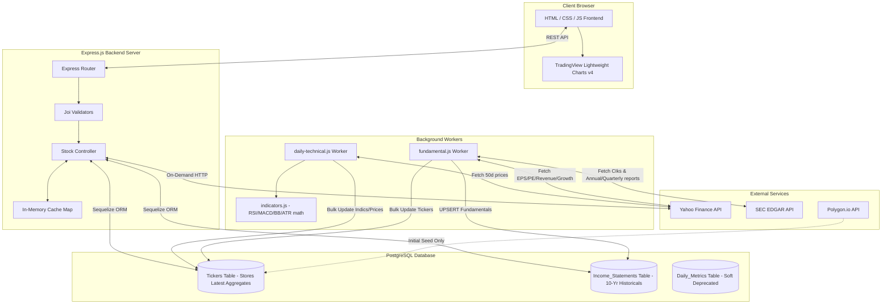

# ScanNasYork — System Overview, Functional (FR) & Non-Functional Requirements (NFR)

This document provides a detailed overview of the system architecture, along with the functional and non-functional requirements of the **ScanNasYork Quantamental Stock Screener**. This documentation reflects the state of the codebase following the Hybrid Data Architecture migration, which optimized database performance for 5,000+ Nasdaq stocks.

---

## 1. System Overview

### 1.1 Project Goal & Scope
**ScanNasYork** is a high-performance, web-based quantamental stock screener designed for Nasdaq-listed equities. The system allows users to filter and analyze over 5,000 stocks using a hybrid mix of technical indicators (e.g., RSI, MACD, Bollinger Bands, ATR) and fundamental parameters (e.g., P/E ratio, EPS, Revenue, EPS YoY growth). It provides clean interactive charting and analyst forecast data on-demand to minimize database size and local resource consumption.

### 1.2 System Architecture
The application is designed using a **Hybrid Data Architecture**:
1. **Pre-computed Storage (PostgreSQL DB):** Standard query parameters, basic metadata, sector types, and latest technical/fundamental metrics are calculated/compiled by background workers and stored directly in the `Tickers` table. This allows the stock screener to perform high-speed filtering, sorting, and pagination across 5,000+ equities in a single indexed query.
2. **On-Demand Proxy (Express.js API):** Interactive price charts and volatile analyst forecasts are fetched dynamically from third-party APIs (Yahoo Finance) in real-time when a user visits a specific stock's detail page. It uses in-memory caching to guarantee high responsiveness and reduce external API rate limiting.

#### Architecture & Data Flow Diagram

### 1.3 Technical Stack
- **Backend:** Node.js (LTS), Express.js framework, Sequelize ORM, PostgreSQL (13+) Database.
- **Frontend:** Vanilla HTML5, Vanilla CSS3 (with dynamic dark-mode styling), Vanilla ES6 JavaScript.
- **Charts:** TradingView Lightweight Charts (v4.x) for candlestick prices and volume; standard canvas rendering for fundamental income statements (Revenue/EPS).
- **Data Integrations:** Yahoo Finance (`yahoo-finance2` library), SEC EDGAR API (JSON Company Facts), Polygon.io API (discovery seeding only).

---

## 2. Functional Requirements (FR)

Functional requirements describe the specific features and actions that the ScanNasYork system must execute.

### 2.1 FR-1: Stock Screener Engine
* **FR-1.1: Filter Multi-Criteria:** The system must filter stocks using combinations of fundamental and technical criteria:
  - *Technical criteria:* RSI (7/14 range), MACD status (positive/negative histogram crossover), Base Building / Low Volatility (Bollinger Band Squeeze where bandwidth <= 5%).
  - *Fundamental criteria:* EPS range (TTM), EPS YoY Growth percentage, P/E Ratio range, Revenue range (TTM), Market Cap range.
  - *Sector/Industry:* Filter by sector categories.
  - *Text Search:* Case-insensitive search matching symbol or company name.
* **FR-1.2: Database Query Performance:** The screener queries must execute entirely against the pre-compiled fields in the [Tickers table](file:///d:/ScanNasYork/ScanNasYork/backend/db/schema.sql) without requiring high-cost joins (such as the deprecated `Daily_Metrics` table).
* **FR-1.3: Pagination and Sorting:** The screener must support `limit`, `offset` (pagination), and `sort_by` fields (e.g., market_cap, rsi_14, current_price, etc.) sorting in both `ASC` and `DESC` orders, keeping null values last.
* **FR-1.4: Caching:** Screener API queries must be cached in backend memory using a TTL (Time-To-Live) cache (default 5 minutes) to ensure repetitive user queries return instantaneously.
* **FR-1.5: CSV Data Export:** The frontend UI must allow downloading the currently filtered and retrieved screener dataset directly as a standard comma-separated values (CSV) file.

### 2.2 FR-2: Detailed Stock Overview & Fundamental Visualization
* **FR-2.1: Stock Detail view:** When clicking on a stock symbol, the user must be redirected to `stock.html?symbol=[SYMBOL]` showing detailed metadata:
  - Company name, sector, industry, and market capitalization.
  - Current price, daily change (%), and current trading volume.
  - Calculated technical indicators (RSI 14, RSI 7, MACD, MACD Signal, MACD Hist, Bollinger Bands, ATR 14).
* **FR-2.2: Historical Financials Table:** The detail page must show tabular financial lists extracted from the [Income_Statements table](file:///d:/ScanNasYork/ScanNasYork/backend/db/schema.sql):
  - *Annual History:* Fiscal Year, Revenue, Net Income, EPS, and Report Date.
  - *Quarterly History:* Fiscal Period (e.g. Q1 2025), Revenue, Net Income, EPS, and Report Date.
* **FR-2.3: Fundamental Financial Charts:** The UI must display an interactive bar chart illustrating historical Revenue and Earnings Per Share (EPS) for both annual and quarterly frequencies, showing chronological oldest-to-newest progress (Zero Data Loss).

### 2.3 FR-3: On-Demand Candlestick Price Charts
* **FR-3.1: TradingView Chart Rendering:** The system must render stock price charts using the TradingView Lightweight Charts library inside the details page, displaying:
  - Candlestick Series (Open, High, Low, Close).
  - Volume Histogram Series (synchronized on the same time scale).
* **FR-3.2: Multi-Timeframe Period Selection:** Users must be able to switch chart views instantly with the following configuration specifications:
  
  | Timeframe Selector | Fetch Back Date Period | Data Interval | Chart Resolution |
  | :--- | :--- | :--- | :--- |
  | **1D** | All-time | 1 Day (`1d`) | Daily Close |
  | **1W** | All-time | 1 Week (`1wk`) | Weekly Close |
  | **1M** | All-time | 1 Month (`1mo`) | Monthly Close |
  | **3M** | All-time | 3 Months (`3mo`) | Quarterly Close |

* **FR-3.3: Proxy On-Demand Fetching:** Chart data must not be stored in the local database. The backend must query the Yahoo Finance API on-demand for the requested timeframe and format it dynamically for the frontend.

### 2.4 FR-4: Analyst Forecast Panel
* **FR-4.1: Real-Time Recommendations:** The detail page must display the consensus rating key (e.g., "buy", "hold", "sell") and mean rating scale (1.0 to 5.0, where 1.0 is Strong Buy and 5.0 is Strong Sell) accompanied by the count of active analyst opinions.
* **FR-4.2: Target Price Metrics:** The system must render a visual target scale mapping the current trading price against analysts' Lowest, Median, Mean, and Highest target estimates.
* **FR-4.3: EPS and Revenue Estimations:** The interface must list the consensus analyst estimates (Average, Low, High, count of analysts) for the current quarter and next quarter.
* **FR-4.4: Surprise History:** The system must show a history table of the last four quarters, displaying estimated EPS vs. actual reported EPS and calculating the resulting surprise percentage.

### 2.5 FR-5: Automated Background Synchronizer (Workers)
* **FR-5.1: Technical Indicators Update Worker:** The worker (`workers/daily-technical.js`) must run periodically (Monday-Friday) to update latest pricing and calculate indicators:
  - Fetch exactly the last 50 trading days of historical data for each ticker (reducing network payloads).
  - Calculate in-memory indicators: RSI (7/14), MACD (12, 26, 9), Bollinger Bands (20, 2), ATR (14).
  - Update values directly in the `Tickers` table.
* **FR-5.2: Fundamental Sync Worker:** The worker (`workers/fundamental.js`) must:
  - Fetch key aggregates from Yahoo Finance (Market Cap, P/E Ratio, TTM EPS, YoY growth metrics).
  - Fetch historical reporting records (up to 10 years) from SEC EDGAR by translating ticker symbols to Central Index Keys (CIK).
  - Upsert quarterly and annual income statements to the database.
* **FR-5.3: Checkpoint Control:** The updates coordinator must run with checkpoint controls to skip symbols updated within the last 12 hours unless a `--force` flag is supplied.

---

## 3. Non-Functional Requirements (NFR)

Non-functional requirements describe how the system must behave under constraints, focusing on qualities like speed, security, rate compliance, and architecture resilience.

### 3.1 Performance & Latency
* **NFR-3.1.1: Core Screener Latency:** Standard requests to the `/api/v1/stocks/screen` endpoint must resolve database queries in less than 25 milliseconds. This is made possible by index optimization on the `Tickers` table.
* **NFR-3.1.2: Server Caching Layer:** In-memory query caching must serve duplicated screener requests in under 2ms.
* **NFR-3.1.3: Third-Party Request Isolation:** Dynamic user actions (detail loading, chart range changes, analyst forecasts) must use asynchronous parallel fetch promises, ensuring that slow Yahoo Finance API queries do not lock other system requests.

### 3.2 Scalability & Database Efficiency
* **NFR-3.2.1: Data Capacity:** The database must scale to support 5,000+ Nasdaq tickers with indexing on core filtered values (`symbol`, `sector`, `pe_ratio`, `rsi_14`, `market_cap`, `current_price`).
* **NFR-3.2.2: Daily Metric Storage Savings:** Daily-granularity tables (`Daily_Metrics`) are soft-deprecated for write processes, saving gigabytes of storage over operational years. All daily historical calculations must be compiled in-memory inside workers.

### 3.3 SEC EDGAR API Compliance & Third-Party Integrity
* **NFR-3.3.1: SEC Rate Limit Enforcer:** To comply with the SEC EDGAR guidelines, the fundamental background workers must enforce a strict sleep timer of at least 150 milliseconds between requests to keep overall throughput safely below the 10 requests/second limit.
* **NFR-3.3.2: User-Agent Identity Declarations:** All network requests made to `sec.gov` must pass custom, verified User-Agent headers containing contact emails (e.g., `ScanNasYork_Project [email]`) to prevent IP banning.
* **NFR-3.3.3: Batch Processing Throttle:** Background workers must process update queries in small batches (e.g., batches of 5-10 stocks) with periodic breathers to prevent remote API firewalls from dropping connection pools.

### 3.4 API Cache Rules & Resiliency
* **NFR-3.4.1: Yahoo Finance API Throttling Mitigation:** The Express backend must enforce separate in-memory caches for:
  - Candlestick Chart requests: 5-minute cache lifespan.
  - Analyst Forecasts: 10-minute cache lifespan.
* **NFR-3.4.2: Offline Failures Resilience:** If an on-demand API call fails (e.g., Yahoo Finance is down or rate-limited), the Express API must return a clean `500` error response with descriptive JSON detail without causing Express runtime execution to crash.

### 3.5 Security
* **NFR-3.5.1: Parametric Validation:** All inbound REST API calls must be validated against robust [Joi schemas](file:///d:/ScanNasYork/ScanNasYork/backend/api/validators.js) before logic routing. Unexpected or malformed query formats must be rejected immediately with a `400 Bad Request` status.
* **NFR-3.5.2: SQL Injection Prevention:** Direct SQL queries are prohibited; all database writes, reads, and dynamic query-building filters must use parameterized constructs built via the Sequelize ORM query layer.
* **NFR-3.5.3: CORS Configuration:** The API server must expose CORS middleware to authorize web interactions under defined safe development/production endpoints.

### 3.6 UI Usability & Modern Aesthetics
* **NFR-3.6.1: Zero-Dependencies Layout:** The web application frontend must build styling systems entirely using Vanilla CSS3 custom properties (CSS variables) to support high performance and zero styling package bloat.
* **NFR-3.6.2: Responsive Display Layout:** The screener table and details analytics widgets must use CSS Flexbox/Grid systems, making pages fully responsive and usable across mobile, tablet, and desktop monitors.
* **NFR-3.6.3: Intuitive Micro-interactions:** UI status transitions, sorting states, table loaders, and timeframe selector switches must include responsive transitions and visual cues (e.g., indicator color changes for overbought/oversold levels, hover animations, indicator badges).
